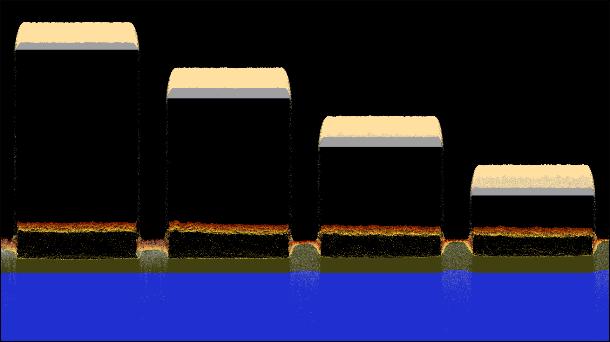

# Big Powder

A falling-sand physics sandbox in the style of [The Powder Toy](https://github.com/The-Powder-Toy/The-Powder-Toy),
simulated on the GPU so the world can be far bigger than TPT's 612×384: up to a 4K screen at one cell per
pixel, and larger zoomable worlds beyond that.

**Status:** Phase 0 (engine spike) is done. A full 4K world of TPT-style water runs at about 120 ticks/s on an
RTX 5080, and no particles are lost or duplicated. Six elements are ported so far: DUST, WATR, OIL, FIRE,
STNE and METL.
- Design and phases: [PLAN.md](PLAN.md)
- Phase 0 numbers: [docs/phase0-results.md](docs/phase0-results.md)



## Building (Linux)

Needs a Vulkan 1.3 GPU and driver.

```bash
sudo apt install cmake ninja-build libsdl3-dev libvulkan-dev vulkan-validationlayers glslc
tools/get-slang.sh
cmake -S . -B build -G Ninja -DCMAKE_BUILD_TYPE=Release
cmake --build build
```

## Running

```bash
./build/big-powder --scene mixed
```

**Drawing and view**

| Action | Control |
|---|---|
| Draw | Left drag |
| Pan | Right or middle drag |
| Zoom | Mouse wheel |
| Brush size | Shift+wheel, or `[` and `]` |
| Select element | `1` DUST, `2` WATR, `3` OIL, `4` FIRE, `5` STNE, `6` METL, `0` erase |

**Other keys**

| Key | Action |
|---|---|
| Space | Pause |
| `.` | Step one tick |
| `H` | Heat view |
| `C` | Cycle colour passes (1×1, 3×3, 5×5) |
| Tab | Next scene |
| `R` | Reload scene |
| `-` / `=` | Simulation speed |
| Home | Fit the view |
| F11 | Fullscreen |
| Esc | Quit |

Useful options:

- `--present mailbox`: uncapped frame rate.
- `--tps N`: simulation ticks per second (default 60, like TPT).
- `--size WxH`: world size.

Benchmarks:

```bash
./build/big-powder --bench --scene all --colours 1,3,5 --batch 2
```

## Licence

GPL-3.0-or-later. This project ports code from The Powder Toy, which is GPL-3.0.
