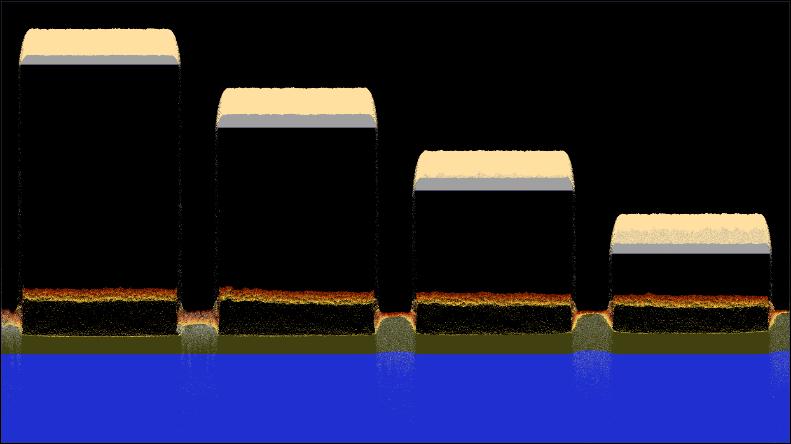

# Phase 0 results: engine spike

Date: 2026-10-20. Hardware: RTX 5080 16 GB, NVIDIA driver 595.91, Ubuntu 26.04 (GNOME, Wayland).

## What was built

- SDL3 + Vulkan 1.3 app with a headless benchmark mode (`--bench`) and an interactive viewer.
- GPU simulation that mirrors TPT's data model:
  - a particle array with TPT's fields;
  - `ptype`, kept as its own array;
  - `pmap`, holding particle id + 1 with a lock bit;
  - air maps at 4×4 px;
  - TPT's element table and `can_move`.
- Six elements ported from TPT v100.1.400: DUST, WATR, OIL, FIRE, STNE, METL.
- Ported code paths:
  - `UpdateParticles` loop body: air drag, gravity, `Loss`, diffusion;
  - `TransitionPhase`: liquid convection, heat conduction, temperature/pressure transitions, Explosive;
  - `PlanMove`, `try_move`/`do_move` and `MovementPhase` for powders, liquids, gases and solids, including the 30 px liquid scan;
  - WATR and FIRE update functions;
  - life decrement and kill from `RecalcFreeParticles`.
- Not yet ported:
  - air solver (only particle-to-air drag);
  - walls, photons and other energy particles, stickmen;
  - Newtonian gravity, ambient heat;
  - transitions into elements that don't exist yet.

## How the parallel update works

Each tick:

1. **Clear and rebuild `pmap`** from the particle list (TPT does the same every frame in `RecalcFreeParticles`).
   Where particles share a cell, the highest id wins, as in TPT.
2. **Sort live particles into N×N colour lists** by position. The grid offset and the order of the passes are
   randomised every tick.
3. **Run N² update passes**, one colour each. Particles in the same pass are a multiple of N pixels apart
   in both axes.
4. **Claim pixels atomically when moving.** A mover locks its own cell, then compare-and-swaps itself into
   the target. A lost race fails like a blocked move does in TPT.
5. **Don't push aside a particle from the current pass.** A mover never swaps with a particle whose update
   may be running in the same pass. This was the cause of a bug found during testing: a particle pushed aside
   while its own update was running acted on a stale position. TPT never has two updates in flight, so
   blocking that swap hides nothing TPT could show.

### Choosing N

- **N=1** (everything at once) is fast but wrong. In the oil-fire scene, burning oil pixels overwrote the
  fire's changes to them with their own stale copies, so fire barely spread: 446 FIRE against 16,000+ with
  N=3 or 5 (612×384, 200 ticks).
- **N=3** keeps a particle's update from overlapping its own neighbours' updates for reactions that reach
  2 px (FIRE's reach). Two far-apart particles can still both write the same third particle; the last write
  wins.
- **N=5** is strictly race-free for reach-2 reactions.
- N=3 and N=5 gave nearly the same results: 433 vs 355 OIL left, 16,047 vs 16,479 FIRE.

**Decision (2026-10-21):** N=5 is the default, because accuracy comes first. It is strictly race-free for
reach-2 reactions and still runs at 120 to 220 ticks/s at 4K. N=3 is available as a faster option
(`--colours 3`, or `C` in the viewer).

## Benchmarks: 3840×2160 world (8.3M cells, 35× TPT)

`--bench --scene all --colours 1,3,5 --warmup 60 --ticks 300 --batch 2`. GPU time per tick from timestamps.
Full output: [bench/phase0-4k.txt](bench/phase0-4k.txt).

| Scene | Particles | 1×1 ms | 3×3 ms | 5×5 ms | 3×3 ticks/s |
|---|---|---|---|---|---|
| empty (walls only) | 36k | 0.09 | 0.16 | 0.32 | ~6000 |
| water (full tank, worst case) | 8.25M | 3.72 | 6.65 | 8.16 | ~150 |
| sand (falling powders) | 3.42M | 2.64 | 5.29 | 6.49 | ~190 |
| rain | 1.51M | 1.34 | 1.92 | 2.32 | ~520 |
| mixed (fire, oil, water, dust) | 2.9M | 1.48 | 3.30 | 4.56 | ~300 |

**Consistency checks** were run after every scene and pass count, looking for:

- particles missing from `pmap`;
- `pmap` entries that point to dead particles;
- `pmap` entries that point to the wrong position;
- cells left locked;
- list overflow;
- stacking.

**All were 0.** Particle counts are conserved exactly in scenes without reactions.

**What this means:**

- A completely full 4K world of TPT water, the worst case, runs at ~150 ticks/s. That's 2.5× the 60 ticks/s
  target.
- Typical scenes run at 200 to 500 ticks/s.

## Viewer

The viewer ran in a 3200×1800 px window with the mixed scene (2.9M particles):

- vsync: 120 fps on the 120 Hz display, sim at 60 ticks/s, 4.5 ms GPU per tick (5×5);
- mailbox present mode: about 2,200 fps;
- immediate mode is not offered by GNOME Wayland, so it falls back to vsync.

Rendering costs very little; the limit is the simulation.

## Known gaps and next steps

- **Sleeping chunks aren't done yet.** All scenes above simulate every particle every tick. Settled areas
  (still water, piles) are where they'll save the most.
- **Stacked particles.** Several particles in one pixel only come from saves. They can move, but only into
  empty cells, like TPT's `move()`. TPT's `CheckStacking` (it turns big stacks into an explosion) isn't
  ported.
- **Particle layout.** `Particle` is 64 bytes, array-of-structs. Splitting out position and type could
  speed up the neighbour scans; this is worth measuring when the element count grows.
- **Rendering.** It uses a placeholder flame colour. TPT's graphics functions and fire glow come in Phase 4.
